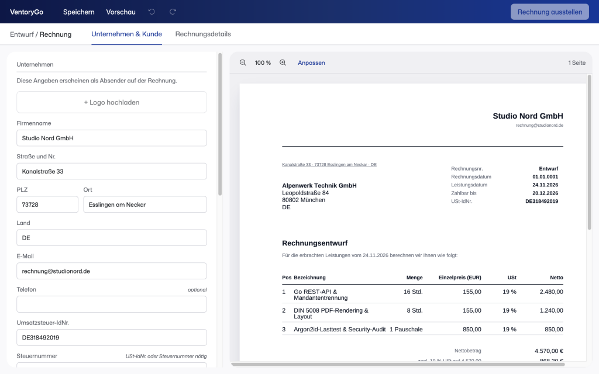
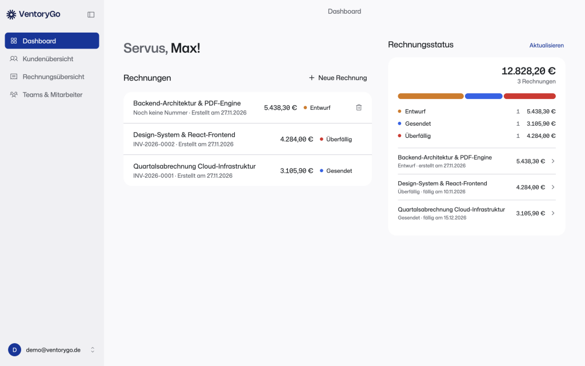
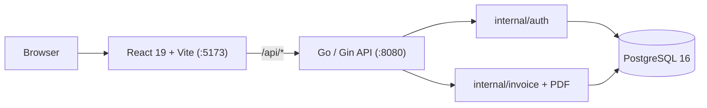

# VentoryGo

**Self-hosted invoicing for freelancers and small businesses, without worrying about tax rules, number sequences, or PDF layout.** Write an invoice, watch the DIN 5008 PDF update live as you type, issue it, and download the finished file. Done.

VentoryGo runs on your own server. The Go backend is built around the parts of an invoice that must never be wrong: every cent adds up, no invoice number is skipped or reused, and no user ever sees another user's data.

[](https://github.com/Mirac61/VentoryGo/actions/workflows/security.yml)
[](https://go.dev/)
[](LICENSE)

<p align="center">
  
</p>

## Highlights

- **Live editor.** Edit sender, customer, and line items on the left and see the PDF update on the right, with autosave.
- **Exact money.** Amounts are `int64` cents and VAT rates are basis points (`1900` = 19 %), never floats.
- **Gap-free invoice numbers.** Assigned atomically per user and year on `issue` (`INV-2026-0001`). Issued invoices are frozen.
- **German tax rules.** VAT per line item and the small-business exemption (§ 19 UStG) with the required legal notice.
- **In-process PDFs.** DIN 5008 Form B rendered directly in Go with embedded fonts, no headless browser.
- **Sessions & tenant isolation.** Foreign invoice IDs return `404`, not `403`. Sessions use `HttpOnly` cookies, SHA-256 token hashes in Postgres, and concurrency-capped Argon2id.

<p align="center">
  
</p>

## Architecture

The backend is split by domain (`internal/auth`, `internal/invoice`), each with handler, service, and repository interface (Postgres via `pgx` and in-memory for fast tests). Pending SQL migrations run automatically on startup.



## Prerequisites

- **Docker** with Docker Compose
- **Go 1.27+** ([go.dev/dl](https://go.dev/dl/))
- **Node.js 24+** and **npm** ([nodejs.org](https://nodejs.org/))

## Getting Started

Create both `.env` files from their templates (use the same Postgres password in both and uncomment `COOKIE_SECURE=false` in `backend/.env` for local HTTP), then start the stack with one command:

```bash
cp .env.example .env
cp backend/.env.example backend/.env

./scripts/dev.sh      # Linux, macOS
.\scripts\dev.ps1     # Windows (PowerShell 7+)
```

To run Postgres, migrations, and the backend completely in Docker instead: `docker compose --profile docker up -d`.

## Usage

Open [http://localhost:5173](http://localhost:5173), register an account, create a draft in the editor, and click **Rechnung ausstellen** to assign its invoice number and download the PDF.

Quick local checks (no database required):

```bash
(cd backend  && test -z "$(gofmt -l .)" && go vet ./... && go test -short -race ./...)
(cd frontend && npm run lint && npm run build)
```

CI (`.github/workflows/ci.yml`) runs the full `go test -race ./...` suite (without `-short`) against PostgreSQL 16; see [`CONTRIBUTING.md`](CONTRIBUTING.md#tests) to configure `TEST_DATABASE_URL` for local database tests.

## Documentation

| Document | Contents |
|---|---|
| [`docs/architecture.md`](docs/architecture.md) | System overview, backend layers, DB ER diagram, atomic numbering, and autosave flow |
| [`docs/self-hosting.md`](docs/self-hosting.md) | Production deployment with Docker Compose, Caddy TLS proxy, and Postgres backups |
| [`CONTRIBUTING.md`](CONTRIBUTING.md) | Setup details, branch & commit conventions, migrations, and Postgres test DB |
| [`backend/README.md`](backend/README.md) | REST API endpoints, error format, cent/quantity math, and Argon2id load-test numbers |
| [`frontend/README.md`](frontend/README.md) | React routes, auth state, autosave queue, and `pdfjs-dist` canvas mechanics |
| [`scripts/README.md`](scripts/README.md) | Step-by-step dev script behavior, `mprocs` support, and common error messages |
| [`docs/adr/README.md`](docs/adr/README.md) | Architecture Decision Records (why server-side sessions, why Maroto v2) |
| [`SECURITY.md`](SECURITY.md) | How to report security vulnerabilities privately |

## License

[AGPL-3.0](LICENSE)
