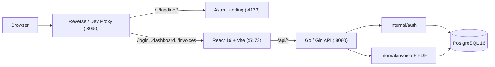
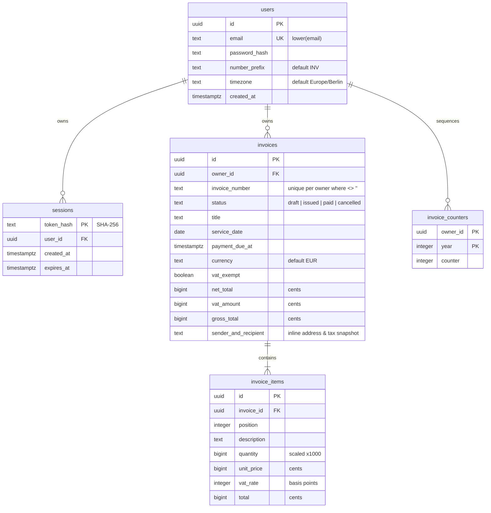
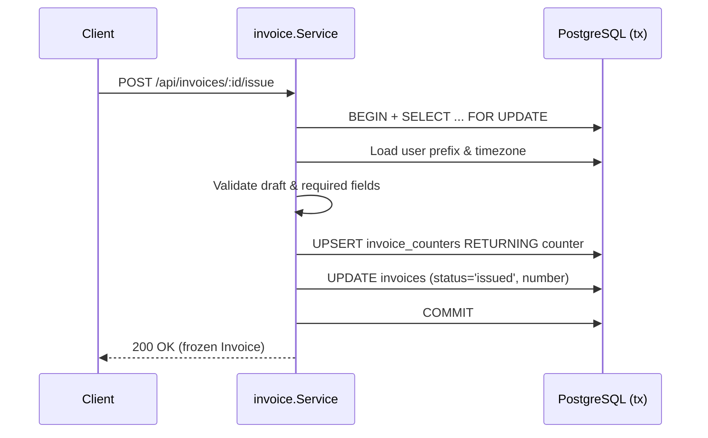
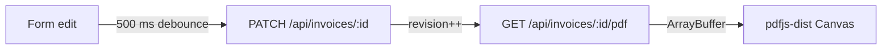

# Architecture

System boundaries, schema, and key flows. Library and protocol decisions live in [`docs/adr/`](adr/README.md).

## System Overview

Single Go binary + PostgreSQL 16 + React 19 SPA. Pending SQL migrations (`backend/migrations/*.sql`) are embedded in the binary and run automatically before `:8080` opens (`MIGRATE_ON_START=false` disables this).



## Backend Structure

```text
backend/
├── main.go / router.go / migrate.go   Wiring, middleware, embedded migrations
└── internal/
    ├── auth/                          Users, Argon2id hasher, sessions, RequireAuth
    ├── invoice/                       Domain model, money/quantity math, numbering, CRUD
    │   └── pdf/                       DIN 5008 Form B generator (Maroto v2 + embedded fonts)
    ├── db/                            pgxpool setup
    └── httperror/                     Request ID + uniform JSON error writer
```

> [!IMPORTANT]
> `internal/auth` and `internal/invoice` never import each other. `router.go` connects them via `user_id` in the Gin context.

| Layer | Responsibility | Details |
|---|---|---|
| **Handler** | HTTP binding & errors | Maps domain errors to `{ code, message, fields, requestId }`; SQL details stay in server logs. |
| **Service** | Business rules | Cent totals, basis-point VAT grouping, § 19 UStG rules, draft-only edit/delete guards. |
| **Repository** | Persistence (`pgx`) | Explicit SQL behind a Go interface, paired with an in-memory implementation for fast tests. |

## Database Schema



| Choice | Reason |
|---|---|
| **Inline addresses on `invoices`** | Issued invoices are legal snapshots; future address edits must never alter past invoices. |
| **Fixed-point integers** | `BIGINT` cents, `INTEGER` basis points (`1900` = 19 %), and `BIGINT` quantities (`×1000`) avoid float drift. |
| **Partial unique index** | `(owner_id, invoice_number) WHERE invoice_number <> ''` allows unlimited drafts (`''`) while enforcing unique numbers once issued. |

## Security & Tenant Isolation

| Mechanism | How it works |
|---|---|
| **Sessions ([ADR 0001](adr/0001-authentifizierung.md))** | `HttpOnly` cookie holds 32 random bytes; PostgreSQL stores only `SHA-256(token)`. |
| **Throttled renewal** | `RequireAuth` extends `expires_at` at most once every 15 minutes (`min(15m, ttl/2)`), avoiding a write per request. |
| **Bounded Argon2id** | Semaphore caps concurrent 19 MiB hashes to `GOMAXPROCS` (`AUTH_HASH_CONCURRENCY`); unknown emails run a dummy hash. |
| **Query-level scoping** | Every query filters by `WHERE id = $1 AND owner_id = $2`; foreign IDs return `404`, never `403`. |

## Issuing an Invoice

`POST /api/invoices/:id/issue` locks the draft, allocates the next gap-free number, and freezes the record in one transaction:



- **No double-issuing:** `FOR UPDATE` serializes parallel calls on the same draft.
- **No skipped numbers:** Counter increments *after* validation inside the transaction; any failure rolls it back.
- **Timezone-accurate year:** Computed in `users.timezone` (`Europe/Berlin`), so New Year's Eve stays in the right tax year.
- **Immutable afterward:** `PUT`, `PATCH`, and `DELETE` reject non-drafts with `409`.

## Editor Autosave & Live PDF



- **Serialized queue (`useInvoiceAutosave`):** One `PATCH` runs at a time; edits typed mid-flight merge into the next request, and unmount flushes pending changes.
- **Partial recovery on `422`:** If a combined patch fails validation, the hook retries field by field so valid fields still save.
- **Stale-free preview (`useInvoicePreview`):** Cancels slower in-flight PDF fetches via `AbortController`; Maroto v2 ([ADR 0002](adr/0002-pdf-bibliothek.md)) derives PDF timestamps from the invoice for byte-identical output.
