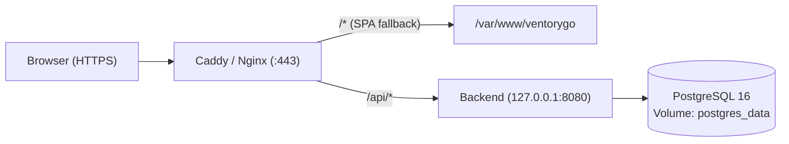

# Self-Hosting

Run VentoryGo on your own VPS, home server, or NAS with Docker Compose and a TLS reverse proxy.

## Production Topology

Serve the static SPA and `/api/*` under **one HTTPS origin** so `HttpOnly; Secure` session cookies work without cross-origin workarounds.



> [!WARNING]
> `docker-compose.yml` publishes `5432` and `8080` on `0.0.0.0` for local development. Ordinary host firewalls such as UFW do **not** reliably block Docker-published ports because Docker routes container traffic in `nat`/`DOCKER` chains before `INPUT` rules apply. On any network-reachable server, override the port bindings to loopback before starting Compose (Step 2) and verify with `ss -tln`.

## 1. Configure Environment

```bash
git clone https://github.com/Mirac61/VentoryGo.git
cd VentoryGo

cp .env.example .env
cp backend/.env.example backend/.env
```

Set a strong password in `.env` (`POSTGRES_PASSWORD`) and put the percent-encoded equivalent into `DATABASE_URL` in `backend/.env`. Keep `COOKIE_SECURE` unset (defaults to `true`).

| File | Variable | Production Value | Notes |
|---|---|---|---|
| `.env` | `POSTGRES_USER` | `invoice_user` | Container DB owner |
| `.env` | `POSTGRES_PASSWORD` | Strong secret | Quote with `'...'` if it contains `#` or spaces |
| `.env` | `POSTGRES_DB` | `invoice_db` | Primary database |
| `backend/.env` | `DATABASE_URL` | `postgres://...` | Used by the `migrate` job (`@` → `%40`, `'` → `%27`) |
| `backend/.env` | `COOKIE_SECURE` | `true` (default) | Requires HTTPS; browsers drop the cookie over plain HTTP |
| `backend/.env` | `AUTH_HASH_CONCURRENCY` | Optional (e.g. `2`) | Lower on small-RAM VPS hosts (19 MiB per parallel Argon2id hash) |

## 2. Bind Ports to Loopback, Build & Start

Create `docker-compose.override.yml` (Docker Compose v2.24.4+; otherwise edit `ports:` in `docker-compose.yml` directly) so PostgreSQL has no host port and the API listens only on `127.0.0.1`:

```yaml
services:
  postgres:
    ports: !reset []
  backend:
    ports: !override
      - "127.0.0.1:8080:8080"
```

Build the SPA, install it into `/var/www/ventorygo` for Caddy, and start the containers:

```bash
(cd frontend && npm ci && npm run build)
sudo install -d -m 0755 /var/www/ventorygo
sudo find /var/www/ventorygo -mindepth 1 -delete
sudo cp -R frontend/dist/. /var/www/ventorygo/
sudo chmod -R a+rX /var/www/ventorygo

docker compose --profile docker up -d --build
```

Verify health and confirm neither `5432` nor `8080` is bound to `0.0.0.0` or `[::]`:

```bash
docker compose --profile docker ps
ss -tln | grep -E ':(5432|8080)\b'   # must show 127.0.0.1:8080 only
```

## 3. Reverse Proxy (Caddy)

Point your domain at the server and configure Caddy (automatic Let's Encrypt TLS):

```caddyfile
invoices.example.com {
    handle /api/* {
        reverse_proxy 127.0.0.1:8080
    }

    handle {
        root * /var/www/ventorygo
        try_files {path} /index.html
        file_server
    }
}
```

## 4. Backups, Restore & Upgrades

**Backup** (owner-only `0700`/`0600` permissions; writes to a temp file first so a failed `pg_dump` never overwrites an existing archive):

```bash
(
  set -euo pipefail
  umask 077
  install -d -m 0700 backups
  target="backups/ventorygo-$(date +%F).sql.gz"
  tmp="$(mktemp backups/.ventorygo-dump.XXXXXX)"
  trap 'rm -f "$tmp"' EXIT
  docker compose exec -T postgres \
    pg_dump -U invoice_user -d invoice_db --clean --if-exists \
    | gzip > "$tmp"
  mv -f "$tmp" "$target"
)
```

**Restore** (stops `backend` first to prevent concurrent writes, runs inside a single transaction with `ON_ERROR_STOP=1`, and restarts `backend` only on success):

```bash
(
  set -euo pipefail
  docker compose --profile docker stop backend
  gunzip -c backups/ventorygo-2026-11-27.sql.gz \
    | docker compose exec -T postgres \
        psql -U invoice_user -d invoice_db --single-transaction -v ON_ERROR_STOP=1
  docker compose --profile docker start backend
)
```

**Upgrade** (migrations apply automatically before the new backend accepts traffic):

```bash
git pull
(cd frontend && npm ci && npm run build)
sudo find /var/www/ventorygo -mindepth 1 -delete
sudo cp -R frontend/dist/. /var/www/ventorygo/
sudo chmod -R a+rX /var/www/ventorygo
docker compose --profile docker up -d --build
```
