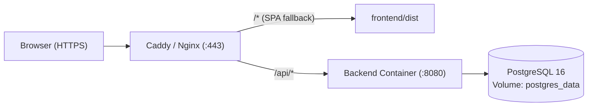

# Self-Hosting

Run VentoryGo on your own VPS, home server, or NAS with Docker Compose and a TLS reverse proxy.

## Production Topology

Serve the static SPA and `/api/*` under **one HTTPS origin** so `HttpOnly; Secure` session cookies work without cross-origin workarounds.



> [!WARNING]
> On a public server, do not expose port `5432` or `8080` to `0.0.0.0`. Bind them to loopback (`127.0.0.1:8080:8080` and remove or loopback-bind `5432:5432`) or block them in your host firewall so all traffic enters through `:443`.

## 1. Configure Environment

```bash
git clone https://github.com/Mirac61/VentoryGo.git
cd VentoryGo

cp .env.example .env
cp backend/.env.example backend/.env
```

Set a strong password in `.env` (`POSTGRES_PASSWORD`) and put the percent-encoded equivalent into `DATABASE_URL` in `backend/.env`. Keep `COOKIE_SECURE` unset (defaults to `true`).

| File | Variable | Production Value | Notes |
|---|---|---|---|
| `.env` | `POSTGRES_USER` | `invoice_user` | Container DB owner |
| `.env` | `POSTGRES_PASSWORD` | Strong secret | Quote with `'...'` if it contains `#` or spaces |
| `.env` | `POSTGRES_DB` | `invoice_db` | Primary database |
| `backend/.env` | `DATABASE_URL` | `postgres://...` | Used by the `migrate` job (`@` → `%40`, `'` → `%27`) |
| `backend/.env` | `COOKIE_SECURE` | `true` (default) | Requires HTTPS; browsers drop the cookie over plain HTTP |
| `backend/.env` | `AUTH_HASH_CONCURRENCY` | Optional (e.g. `2`) | Lower on small-RAM VPS hosts (19 MiB per parallel Argon2id hash) |

## 2. Build & Start

Build the frontend bundle and start PostgreSQL, migrations, and the Go API:

```bash
cd frontend && npm ci && npm run build && cd ..
docker compose --profile docker up -d --build
```

Check health:

```bash
docker compose --profile docker ps
docker compose --profile docker logs -f backend
```

## 3. Reverse Proxy (Caddy)

Point your domain at the server and configure Caddy (automatic Let's Encrypt TLS):

```caddyfile
invoices.example.com {
    handle /api/* {
        reverse_proxy 127.0.0.1:8080
    }

    handle {
        root * /srv/ventorygo/frontend/dist
        try_files {path} /index.html
        file_server
    }
}
```

## 4. Backups & Upgrades

**Backup** (consistent snapshot via `pg_dump`):

```bash
docker compose exec -T postgres \
  pg_dump -U invoice_user -d invoice_db --clean --if-exists \
  | gzip > "ventorygo-$(date +%F).sql.gz"
```

**Restore:**

```bash
gunzip -c ventorygo-2026-11-27.sql.gz \
  | docker compose exec -T postgres psql -U invoice_user -d invoice_db
```

**Upgrade** (migrations apply automatically before the new backend accepts traffic):

```bash
git pull
cd frontend && npm ci && npm run build && cd ..
docker compose --profile docker up -d --build
```
